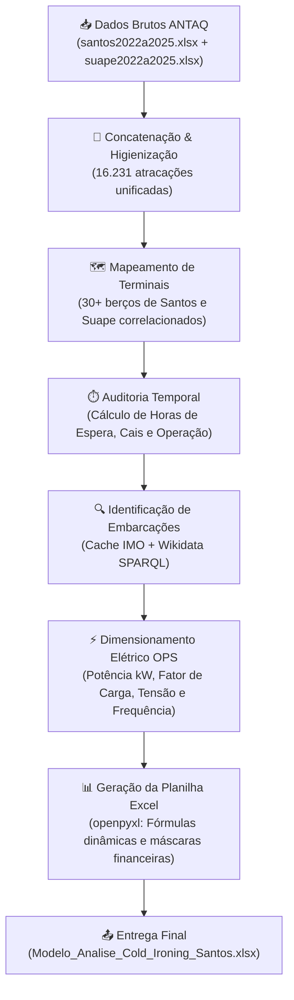

# 🚢 Viabilidade Técnica e Operacional de Cold Ironing (Shore Power / OPS) nos Portos de Santos e Suape

<p align="center">
  
  
  
  
  
</p>

---

## 📌 Sumário
- [1. Sobre o Projeto](#-1-sobre-o-projeto)
  - [Autores e Orientadores](#autores-e-orientadores)
  - [Contexto e Justificativa](#contexto-e-justificativa)
- [2. Estrutura do Repositório](#-2-estrutura-do-repositório)
- [3. Metodologia e Pipeline de Dados](#-3-metodologia-e-pipeline-de-dados)
  - [Fluxo de Processamento (ETL)](#fluxo-de-processamento-etl)
  - [Enriquecimento Naval via IMO e Wikidata](#enriquecimento-naval-via-imo-e-wikidata)
  - [Parâmetros Técnicos e Regulatórios (CARB / IMO / EPA)](#parâmetros-técnicos-e-regulatórios-carb--imo--epa)
- [4. Principais Resultados e Indicadores](#-4-principais-resultados-e-indicadores)
  - [Consolidação das Atracações (2022–2025)](#consolidação-das-atracações-20222025)
  - [Tempos Operacionais de Permanência](#tempos-operacionais-de-permanência)
  - [Matriz Comparativa: Santos × Suape × Los Angeles](#matriz-comparativa-santos--suape--los-angeles)
  - [Estimativa de Potência e Demanda Elétrica](#estimativa-de-potência-e-demanda-elétrica)
- [5. Como Reproduzir o Projeto](#-5-como-reproduzir-o-projeto)
  - [Pré-requisitos](#pré-requisitos)
  - [Instalação e Execução](#instalação-e-execução)
- [6. Documentos Acadêmicos Complementares](#-6-documentos-acadêmicos-complementares)
- [7. Licença](#-7-licença)

---

## 🏫 1. Sobre o Projeto

Este projeto avalia a **viabilidade técnica e operacional de implementação da tecnologia de *Cold Ironing* (também conhecida como *Onshore Power Supply* - OPS ou *Shore Power*)** nos dois principais portos de referência do Brasil:
- **Porto de Santos (SP)** — maior complexo portuário da América Latina (grande porte);
- **Porto de Suape (PE)** — hub industrial e de transbordo do Nordeste (médio/grande porte).

Como parâmetro internacional de excelência regulatória e tecnológica, utilizou-se o **Porto de Los Angeles (POLA, Califórnia - EUA)**, pioneiro mundial onde mais de 95% dos navios regulamentados conectam-se à energia de terra em função das diretrizes do **CARB (*California Air Resources Board*)**.

### Autores e Orientadores

* **Pesquisadores / Autores:**
  * **Giulia Dias Granado de Marques** ([giulia.marques@cps.sp.gov.br](mailto:giulia.marques@cps.sp.gov.br))
  * **Luiz Felipe Honório Avelino** ([luiz.avelino@aluno.cps.gov.br](mailto:luiz.avelino@aluno.cps.gov.br))
  * **Suany Milena da Silva Rosa** ([suany.rosa@aluno.cps.gov.br](mailto:suany.rosa@aluno.cps.gov.br))

* **Orientadores:**
  * **Prof. Dr. Luiz Carlos Rodrigues Tavares** ([luiz.tavares@cps.sp.gov.br](mailto:luiz.tavares@cps.sp.gov.br))
  * **Prof. Dr. José Augusto Theodosio Pazetti** ([jose.pazetti@cps.sp.gov.br](mailto:jose.pazetti@cps.sp.gov.br))

* **Instituição:** **Faculdade de Tecnologia da Baixada Santista – Rubens Lara (FATEC Baixada Santista)**  
* **Eixo Temático:** Tecnologia e Inovação no Ambiente Portuário  
* **Subtema:** Sustentabilidade e Eficiência Energética  

---

### Contexto e Justificativa

Durante a fase de atracação (*hotelling*), os navios mantêm seus motores auxiliares a diesel ligados ininterruptamente para suprir sistemas de refrigeração, bombas de descarga de carga líquida, iluminação, guindastes e hotelaria de bordo. Essa queima contínua de combustível fóssil gera elevados volumes de gases de efeito estufa ($\text{CO}_2$) e poluentes atmosféricos locais ($\text{NO}_x$, $\text{SO}_x$ e Material Particulado - $\text{PM}_{2.5}$ / $\text{PM}_{10}$), afetando diretamente as comunidades urbanas lindeiras aos portos de Santos e Suape.

O *Cold Ironing* viabiliza o desligamento dos geradores auxiliares a diesel mediante a conexão física do navio à rede elétrica de terra. No Brasil, o benefício ambiental é potencializado pela matriz elétrica do **Sistema Interligado Nacional (SIN)**, predominantemente renovável (fator médio de apenas $0,08\text{ kg CO}_2/\text{kWh}$, contra $690\text{ g CO}_2/\text{kWh}$ da queima de óleo diesel marítimo).

---

## 📁 2. Estrutura do Repositório

```plaintext
cold-ironing-viabilidade-portos-brasil/
├── README.md                                # Documentação completa e relatório executivo
├── LICENSE                                  # Licença de código aberto (MIT)
├── requirements.txt                         # Dependências Python para execução do pipeline
├── process_cold_ironing.py                  # Script ETL de automação, cálculos e modelagem Excel
├── imo_cache.json                           # Base persistida de 3.942 navios (consultada via Wikidata)
│
├── dados/                                   # Bases de dados públicas oficiais de entrada (ANTAQ)
│   ├── santos2022a2025.xlsx                 # 9.814 atracações do Porto de Santos (2022–2025)
│   └── suape2022a2025.xlsx                  # 6.417 atracações do Porto de Suape (2022–2025)
│
├── output/                                  # Saídas geradas pelo modelo computacional
│   └── Modelo_Analise_Cold_Ironing_Santos.xlsx # Pasta de trabalho Excel com 16.231 linhas e fórmulas
│
└── docs/                                    # Artigos, banners e relatórios acadêmicos do projeto
    ├── banner_cold_ironing.pdf              # Banner acadêmico apresentado em evento científico
    ├── banner_cold_ironing_editavel.docx    # Conteúdo integral e fontes do banner acadêmico
    ├── Matriz de indicadores – Cold ironing Los Angeles × Santos × Suape (Completa).docx
    └── relatorio_cientifico_emissoes_navios (1).docx
```

---

## 🔬 3. Metodologia e Pipeline de Dados

O estudo baseou-se em uma abordagem mista, combinando levantamento bibliográfico e documental com **análise empírica quantitativa** sobre registros públicos da **Agência Nacional de Transportes Aquaviários (ANTAQ)**, **Autoridade Portuária de Santos (APS)**, **Operador Nacional do Sistema Elétrico (ONS)** e **ANEEL**.

### Fluxo de Processamento (ETL)

O script [`process_cold_ironing.py`](process_cold_ironing.py) foi construído em Python, estruturado em 8 etapas automatizadas:



### Enriquecimento Naval via IMO e Wikidata

Para calcular a demanda energética real por atracação, foi necessário identificar as características físicas de cada embarcação (Arqueação Bruta - GT, Porte Bruto - DWT e Tipologia Naval):
1. **Extração de Códigos IMO**: Identificados **4.821 números IMO únicos** nas operações entre 2022 e 2025.
2. **Consultas SPARQL em Lote à Wikidata**: O script envia requisições em lotes via método `POST` ao endpoint SPARQL da Wikimedia, consultando a propriedade P792 (*IMO ship identification number*).
3. **Persistência em Cache (`imo_cache.json`)**: **3.942 embarcações (81,8% do total)** foram cadastradas com nome oficial, arqueação bruta e tipologia, cobrindo **13.287 escalas (81,9% do tráfego portuário total)**.
4. **Fallback Paramétrico**: As 879 embarcações restantes ou sem IMO foram tipificadas por cruzamento de regras heurísticas do berço e carga operada.

### Parâmetros Técnicos e Regulatórios (CARB / IMO / EPA)

As faixas de potência e demanda por classe naval adotaram os padrões internacionais de referência:

| Tipo de Embarcação | Potência Auxiliar Típica ($P_{\text{aux}}$) | Fator de Carga Hotelling ($LF$) | Tensão / Frequência (IEC/IEEE 80005) |
|---|---|---|---|
| **Porta-Contêineres** | $1.500\text{ kW}$ a $3.500\text{ kW}$ | $20\%$ | $6.600\text{ V} / 60\text{ Hz}$ |
| **Petroleiros / Granéis Líquidos** | $5.000\text{ kW}$ a $10.000\text{ kW}$ | $22\%$ | $6.600\text{ V} / 60\text{ Hz}$ |
| **Navios de Cruzeiro** | $7.000\text{ kW}$ a $16.000\text{ kW}$ | $16\%$ | $6.600\text{ V} / 60\text{ Hz}$ ou $11.000\text{ V}$ |
| **Graneleiros Sólidos** | $1.400\text{ kW}$ a $2.200\text{ kW}$ | $18\%$ | $6.600\text{ V} / 60\text{ Hz}$ ou $440\text{ V}$ |
| **Carga Geral / Ro-Ro** | $1.200\text{ kW}$ a $2.500\text{ kW}$ | $18\%$ | $6.600\text{ V} / 60\text{ Hz}$ |
| **Apoio Marítimo (Offshore)** | $600\text{ kW}$ a $1.200\text{ kW}$ | $20\%$ | $440\text{ V} / 60\text{ Hz}$ |

---

## 📊 4. Principais Resultados e Indicadores

### Consolidação das Atracações (2022–2025)

* **Volume Total de Escalas**: **16.231 atracações**
  * **Porto de Santos**: 9.814 atracações (60,5%)
  * **Porto de Suape**: 6.417 atracações (39,5%)
* **Consistência dos Dados**: **0 inconsistências cronológicas** (todas as escalas apresentaram $\Delta t \ge 0$).

### Tempos Operacionais de Permanência

| Indicador Operacional | Média Portuária Geral | Mediana Portuária | Santos (Típico) | Suape (Típico) |
|---|---|---|---|---|
| **Horas de Espera na Barra** | **102,22 h** (~4,2 dias) | **23,25 h** | 30 a 70 h | 40 a 90 h |
| **Tempo de Permanência no Cais ($T_A$)** | **82,47 h** (~3,4 dias) | **50,10 h** | 45 a 65 h | 60 a 95 h |
| **Tempo Efetivo de Operação ($T_{\text{op}}$)** | **72,49 h** (~3,0 dias) | **39,17 h** | 38 a 55 h | 50 a 85 h |

> 📌 **Conclusão Operacional:** O longo tempo de permanência no cais (média $> 80\text{ horas}$) indica uma **janela de conexão elétrica altamente atrativa** para amortização do investimento de Cold Ironing em relação a Los Angeles (onde porta-contêineres operam em janelas curtas de 18 a 28 h).

---

### Matriz Comparativa: Santos × Suape × Los Angeles

Baseada no documento [`Matriz de indicadores`](docs/Matriz%20de%20indicadores%20–%20Cold%20ironing%20Los%20Angeles%20×%20Santos%20×%20Suape%20(Completa).docx):

| Dimensão de Análise | Porto de Los Angeles (EUA) | Porto de Santos (Brasil) | Porto de Suape (Brasil) |
|---|---|---|---|
| **Perfil Predominante** | Porta-contêineres e cruzeiros | Porta-contêineres, graneis e cruzeiros | Granéis líquidos (petróleo/derivados) |
| **Mandato Regulatório** | Obrigatório por lei estadual (CARB) | Inexistente (estudos preliminares) | Inexistente (estudos de frota iniciados) |
| **Atracações com Shore Power** | $> 95\%$ em conformidade | $0\%$ (em fase de projeto) | $0\%$ (em fase de projeto) |
| **Matriz Elétrica Fornecedora** | Mista (gás natural, renováveis) | Predominantemente renovável (SIN - MCTI) | Predominantemente renovável (SIN - MCTI) |
| **Fator de Emissão de Rede** | $\approx 0,22\text{ kg CO}_2/\text{kWh}$ | **$0,08\text{ kg CO}_2/\text{kWh}$** | **$0,08\text{ kg CO}_2/\text{kWh}$** |
| **Gargalo Principal** | Adequação de navios antigos | Capacidade de subestações portuárias | Demanda extrema em granéis líquidos |

---

### Estimativa de Potência e Demanda Elétrica

As fórmulas ativas na aba `Análise por Escala` da planilha calculam dinamicamente:
* **Demanda Média por Navio**: Potência Auxiliar (kW) × Fator de Carga
* **Consumo de Energia**: Demanda Média (kW) × Horas no Cais (h)
* **Emissão com Diesel (tCO₂)**: Consumo (kWh) × Fator de Emissão do Diesel (690 gCO₂/kWh)
* **Emissão com Rede (tCO₂)**: Consumo (kWh) × Fator de Emissão da Rede Elétrica (0,08 kgCO₂/kWh)
* **CO₂ Evitado (tCO₂)**: Emissão com Diesel − Emissão com Rede
* **Custo da Energia Elétrica**: Consumo (kWh) × Tarifa Portuária (R$ 0,75/kWh)

---

## 🚀 5. Como Reproduzir o Projeto

### Pré-requisitos
* Python 3.9 ou superior instalado.
* Gerenciador de pacotes `pip`.

### Instalação e Execução

1. **Clone o repositório:**
   ```bash
   git clone https://github.com/giuliagranado/cold-ironing-viabilidade-portos-brasil.git
   cd cold-ironing-viabilidade-portos-brasil
   ```

2. **Instale as dependências necessárias:**
   ```bash
   pip install -r requirements.txt
   ```

3. **Execute o pipeline completo de processamento:**
   ```bash
   python process_cold_ironing.py
   ```

4. **Verifique os resultados gerados:**
   * Acompanhe o log gerado em tempo real no console ou em `execucao.log`.
   * A planilha preenchida será atualizada em `output/Modelo_Analise_Cold_Ironing_Santos.xlsx`.

---

## 📄 6. Documentos Acadêmicos Complementares

Os arquivos originais de pesquisa encontram-se arquivados no diretório [`docs/`](docs/):
- **`banner_cold_ironing.pdf`**: Banner acadêmico com resumo gráfico e conclusões.
- **`Matriz de indicadores – Cold ironing Los Angeles × Santos × Suape (Completa).docx`**: Matriz analítica aprofundada comparando os três portos.
- **`relatorio_cientifico_emissoes_navios (1).docx`**: Análise estatística de emissões navais e impacto econômico (2020–2025).

---

## 📜 7. Licença

Este projeto está distribuído sob a licença **MIT**. Consulte o arquivo [LICENSE](LICENSE) para mais informações.
