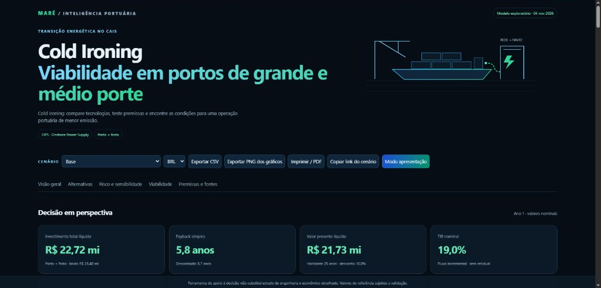
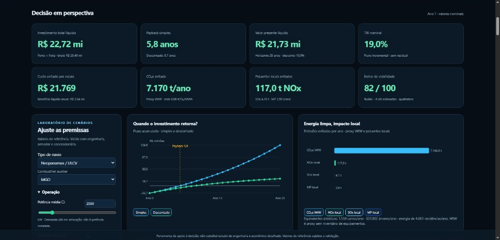
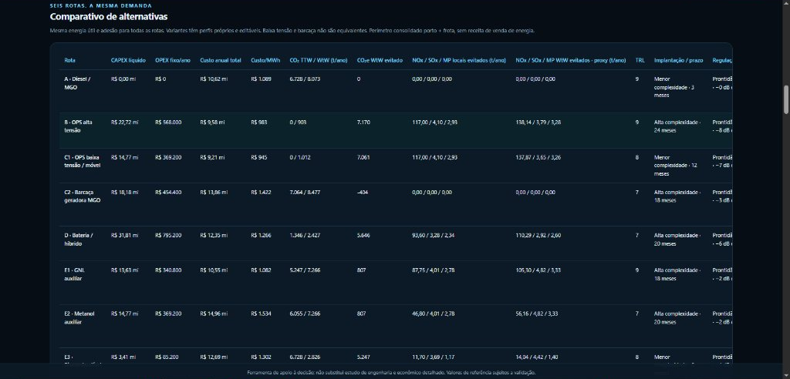
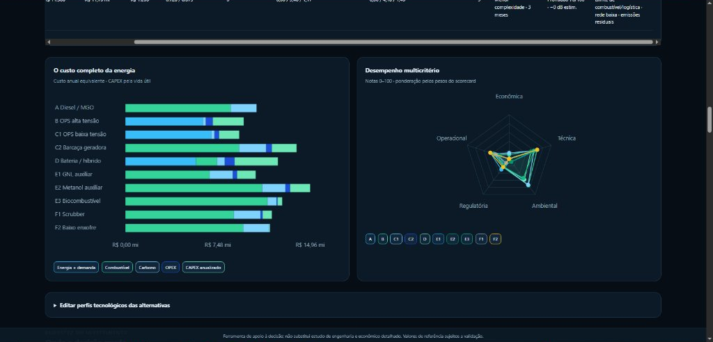
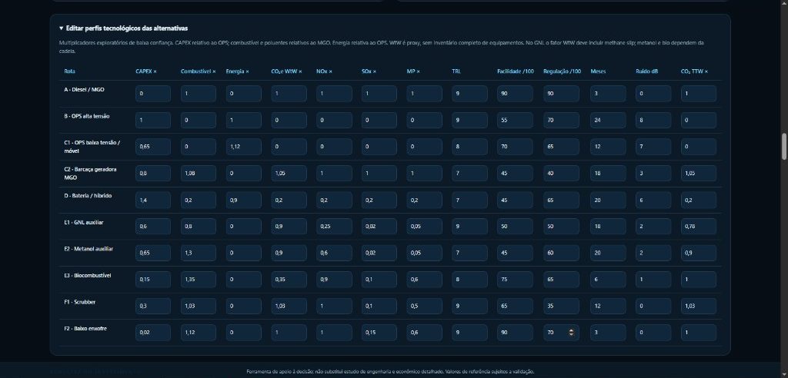
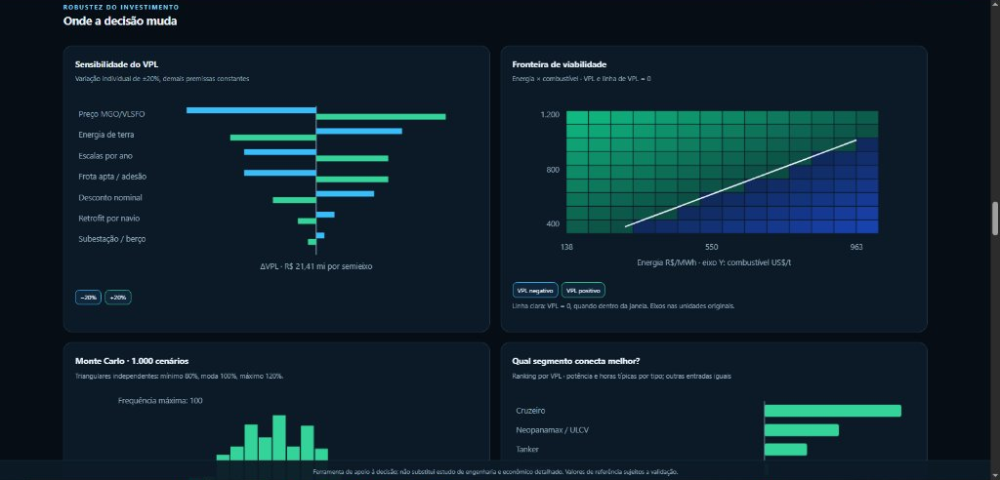
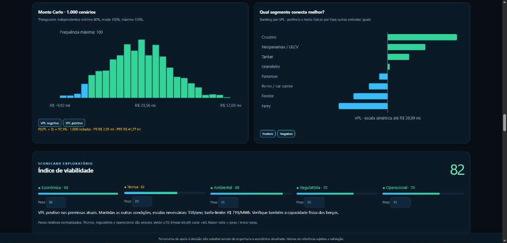
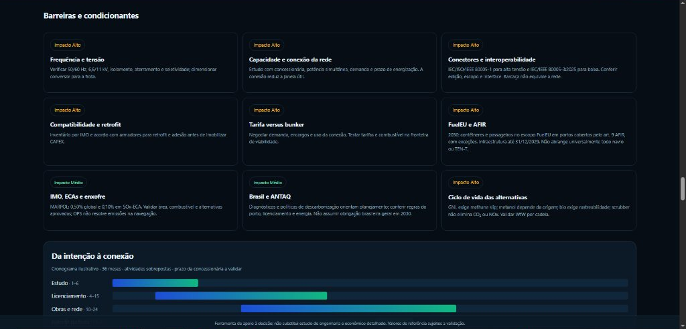
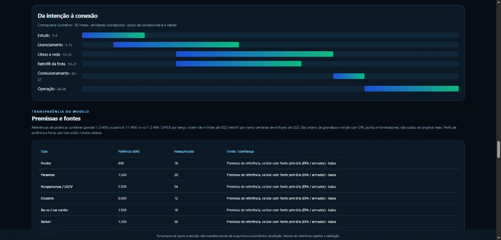

# 📊 Dashboard Interativo: Viabilidade de Cold Ironing em Portos Brasileiros

Este diretório reúne a aplicação interativa [`cold-ironing-dashboard.html`](cold-ironing-dashboard.html), desenvolvida como ferramenta de apoio à decisão para a transição energética portuária e implantação de sistemas de **Cold Ironing (Onshore Power Supply - OPS / Shore Power)** nos portos de Santos e Suape.

> ⚠️ **Nota sobre as capturas de tela:**  
> As imagens documentadas abaixo cobrem a **maior parte** dos módulos, visualizações e ferramentas interativas desenvolvidas no dashboard. Contudo, por se tratar de uma aplicação web dinâmica completa (com seletores em tempo real, tabelas interativas, sliders paramétricos e relatórios expansíveis), alguns componentes secundários e opções avançadas de exportação não aparecem de forma exaustiva nas prints.  
> Para vivenciar a experiência completa, basta abrir o arquivo [`cold-ironing-dashboard.html`](cold-ironing-dashboard.html) diretamente no seu navegador.

---

## 📸 Galeria e Detalhamento das Telas do Dashboard

### 1. Visão Geral — Indicadores Chave e Decisão em Perspectiva

* **Barra Superior de Ferramentas:** Seleção rápida de cenários pré-configurados (*Base*, *Porta-contêineres*, *Cruzeiros*, etc.), alternância de moeda (BRL / USD), exportação de dados para CSV, download de gráficos em PNG, impressão/PDF, link direto compartilhável e modo apresentação em tela cheia.
* **Painel Executivo ("Decisão em Perspectiva"):** Síntese financeira consolidada com **Investimento Total Líquido (R$ 22,72 mi)**, **Payback Simples (5,8 anos)**, **Valor Presente Líquido - VPL (R$ 21,73 mi)** e **Taxa Interna de Retorno nominal - TIR (19,0%)**.

---

### 2. Laboratório de Cenários, Retorno Financeiro e Impacto Ambiental

* **Métricas Unitárias:** Custo evitado por atracação (R$ 21.769), redução de gases de efeito estufa (**7.170 t/ano de CO₂e**), poluentes locais evitados (**117,0 t de NOₓ**) e Índice Geral de Viabilidade (82 / 100).
* **Laboratório Paramétrico:** Sliders e campos numéricos para ajuste em tempo real da classe do navio (*Neopanamax / ULCV*), combustível auxiliar (*MGO*), potência útil de atracação (2.500 kW) e horas de cais.
* **Gráficos Dinâmicos:**
  * *Quando o investimento retorna?* Curvas de fluxo de caixa acumulado simples e descontado ao longo do horizonte de 25 anos.
  * *Energia limpa, impacto local:* Balanço de emissões evitadas por poluente (CO₂e Well-to-Wake, NOₓ, SOₓ e Material Particulado).

---

### 3. Comparativo de Alternativas Tecnológicas (Seis Rotas, a Mesma Demanda)

* **Matriz Comparativa Abrangente:** Confronto direto entre 8 rotas tecnológicas sob a mesma demanda de energia no cais:
  1. **Rota A:** Diesel marítimo convencional (*MGO baseline*);
  2. **Rota B:** OPS / Cold Ironing de alta tensão (6,6 kV / 11 kV);
  3. **Rota C1:** OPS de baixa tensão / solução móvel (440 V);
  4. **Rota C2:** Barcaça geradora a MGO com tratamento de gases;
  5. **Rota D:** Sistemas a bateria / propulsão híbrida;
  6. **Rotas E1 e E2:** Combustíveis auxiliares alternativos (GNL e Metanol);
  7. **Rotas E3, F1 e F2:** Biocombustíveis, Scrubbers (depuradores) e óleo de baixíssimo enxofre.
* **Critérios Avaliados:** CAPEX líquido, OPEX fixo/ano, Custo total anualizado, Custo por MWh útil, Emissões TTW e WTW evitadas, Maturidade tecnológica (**TRL**), prazo de implantação e prontidão regulatória.

---

### 4. Custo Completo da Energia e Desempenho Multicritério

* **O Custo Completo da Energia:** Gráfico de barras horizontais empilhadas decompondo o Custo Anual Equivalente de cada tecnologia em: energia e demanda contratada, combustível consumido, precificação de carbono, despesas operacionais (OPEX) e amortização de CAPEX.
* **Desempenho Multicritério (Radar):** Gráfico pentagonal pontuando cada alternativa em 5 dimensões estratégicas: **Econômica**, **Técnica**, **Ambiental**, **Regulatória** e **Operacional**.

---

### 5. Edição Avançada dos Perfis Tecnológicos

* **Customização de Parâmetros de Engenharia:** Painel expansível que concede flexibilidade ao pesquisador e gestor para calibrar multiplicadores de CAPEX relativo, consumo específico, fatores de emissão Well-to-Wake (WTW), facilidade operacional (/100), prazos de licenciamento/obra em meses e mitigação de ruído acústico no porto (dB).

---

### 6. Análise de Risco — Diagrama Tornado e Fronteira de Viabilidade

* **Diagrama Tornado (Sensibilidade do VPL):** Demonstra a variação do VPL diante de oscilações de ±20% nas variáveis críticas do projeto, comprovando que a volatilidade do preço do bunker (MGO/VLSFO) e a tarifa de energia elétrica terrestre são os principais determinantes do retorno econômico.
* **Fronteira de Viabilidade:** Matriz bidimensional de sensibilidade cruzando a tarifa da energia elétrica (R$/MWh) contra o preço do bunker (US$/t), demarcando claramente a isolinha onde o projeto atinge viabilidade financeira positiva (VPL > 0).

---

### 7. Simulação Estocástica de Monte Carlo e Ranking por Segmento

* **Monte Carlo (1.000 Cenários):** Histograma de distribuição de probabilidades considerando variações triangulares independentes em custos e demandas. O modelo indica **97,3% de probabilidade de VPL positivo**, com intervalo de confiança P5 a P95.
* **Qual Segmento Conecta Melhor?** Ranking comparativo de atratividade financeira por perfil naval, evidenciando maior retorno e volume para **Navios de Cruzeiro** e porta-contêineres **Neopanamax / ULCV**.
* **Scorecard Ponderado:** Painel de ponderação customizável que consolida a nota de viabilidade (82/100) com base no peso relativo de cada pilar estratégico.

---

### 8. Barreiras e Condicionantes da Transição Energética

* **Mapeamento de Riscos e Desafios:** Cards estruturados com indicação do nível de criticidade (*Impacto Alto* e *Médio*) sobre:
  * Compatibilização de frequência (50 Hz vs 60 Hz) e níveis de tensão (6,6 kV vs 11 kV);
  * Capacidade da subestação e reforço da rede de distribuição local;
  * Padrões internacionais de conectores e cabos (**IEC/IEEE 80005**);
  * Custo e logística de retrofit dos navios de cabotagem e longo curso;
  * Paridade tarifária de energia elétrica vs. bunker marítimo;
  * Requisitos das regulamentações internacionais (**FuelEU Maritime**, **AFIR** e **MARPOL**) e marcos regulatórios da **ANTAQ**.

---

### 9. Cronograma de Implantação e Transparência Metodológica

* **Da Intenção à Conexão (Cronograma Gantt):** Roteiro temporal ilustrativo em 36 meses com marcos encadeados:
  * Meses 1 a 6: Estudos preliminares de viabilidade e engenharia conceitual;
  * Meses 4 a 15: Licenciamento ambiental e aprovações regulatórias;
  * Meses 10 a 24: Obras civis, subestação e extensão da infraestrutura de rede;
  * Meses 10 a 21: Acordos de retrofit e preparação da frota atracada;
  * Meses 25 a 27: Comissionamento elétrico e testes de sincronismo;
  * Meses 28 a 36+: Operação assistida e expansão de berços.
* **Transparência do Modelo:** Tabela de parâmetros de referência por tipo de embarcação (*Feeder*, *Panamax*, *Neopanamax*, *Cruzeiro*, *Ro-Ro*, *Tanker*), explicitando potências auxiliares médias (kW), tempos médios de escala e níveis de confiança metodológica.

---

## 🚀 Como Executar o Dashboard Localmente

O dashboard é completamente autônomo (não necessita de backend, Node.js, Python ou servidores web dedicados):

1. Clone o repositório ou navegue até esta pasta:
   ```bash
   cd dashboard
   ```
2. Dê um duplo clique no arquivo [`cold-ironing-dashboard.html`](cold-ironing-dashboard.html) ou abra-o diretamente no navegador de sua preferência (Google Chrome, Microsoft Edge, Mozilla Firefox ou Safari).
